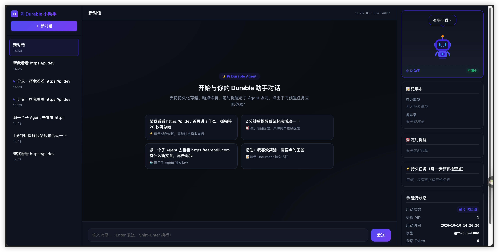

# Pi Durable Assistant

**A self-hosted, durable AI assistant** powered by [Pi Durable](https://github.com/earendil-works/pi), with crash recovery, long-running tasks, background subagents, scheduled jobs, SQLite persistence, a web chat interface, and an optional WeChat iLink bridge.

[简体中文 README](README.md) · [Getting started](docs/GETTING_STARTED.md) · [Configuration](docs/CONFIGURATION.md) · [Deployment](docs/DEPLOYMENT.md)

[](https://github.com/kingus188/pi-durable-assistant/actions/workflows/v3-ci.yml)
[](LICENSE)



> **Status: experimental, single-user project.** Not an official Pi Durable product. The `main` branch does not include all open feature PRs. Back up your SQLite volume and restrict access before using a VPS.

## What does it do?

Unlike a disposable chatbot session, this project wraps the Pi Durable runtime in a browser-based personal assistant. Task and conversation state is committed to persistent storage, so recoverable work can resume after a process restart.

| Feature | On `main` |
| --- | --- |
| Crash recovery | Persistent Durable tasks, checkpoints and conversation state |
| Web chat | Multiple conversations, forking, live SSE updates and usage display |
| Subagents | Foreground `delegate` and background `delegate_background` |
| Scheduled jobs | One-off or fixed-minute recurring tasks; pause, resume and cancel |
| Memory notes | Persistent `todo` and `memo` tools |
| Attachments | Browser uploads for PNG/JPEG/WebP/GIF images and UTF-8 text/code files |
| WeChat | Optional iLink bridge for text and voice-transcription text, with its own outbox |
| Notifications | Optional generic Webhook or Feishu text bot; **best-effort on main** |
| Export | Visible user/assistant messages to Markdown |
| Long-term memory | `propose_memory` stays pending until approved in the task center. Text you enter there applies immediately. Stored only in local SQLite |
| Skills | Approved skills expose only a name and trigger in the prompt. The model reads the full text with `read_skill` |
| Notes search | Optional read-only search of an allowlisted Obsidian vault, with path and line citations. Nothing is written back |
| Conversation list | Archive or remove a chat from the menu. Archive also stops that chat's unfinished reminders, schedules and background jobs. Removal drops the menu row only |

**Tech stack:** Node.js 22+, TypeScript with native ESM, Pi Durable 1.1.0, SQLite, Docker Compose. Compiled with `tsc`; no frontend framework, bundler or external database server required.

## Quick start — no API key

```bash
git clone https://github.com/kingus188/pi-durable-assistant.git
cd pi-durable-assistant
npm ci
npm run check
LLM_API=faux npm run dev
```

Open **http://127.0.0.1:3000**, create a conversation, and open **Task Center** at the bottom-right.

`faux` is a deterministic local test script: **it does not behave like a real LLM**. It exists to demonstrate tasks, UI and restart recovery without spending tokens.

## Connect a real model

```bash
cp .env.example .env
# Set LLM_API, LLM_BASE_URL, LLM_API_KEY and LLM_MODEL in .env
set -a
. ./.env
set +a
npm run dev
```

Supported API protocol types: `openai-completions`, `openai-responses` and `anthropic-messages`. Compatibility and usage charges depend on your provider or proxy; don't assume all models support the same API. Never commit `.env`, API credentials or WeChat sessions.

## Self-host with Docker Compose

```bash
cp .env.example .env
# Set DEMO_PASSWORD and real model configuration
docker compose up -d --build
docker compose ps
```

The container is published only at **127.0.0.1:3300** by default. For remote access, configure an HTTPS reverse proxy and retain HTTP Basic Auth (`demo` username). SQLite and WeChat session data live in persistent Docker volumes: **do not run `docker compose down -v` as an upgrade command**.

See [deployment and backup guidance](docs/DEPLOYMENT.md), [troubleshooting](docs/TROUBLESHOOTING.md), and the [WeChat iLink guide](docs/WECHAT.md) (Chinese).

## Important limitations

- The assistant is a single-user application, not a multi-tenant service.
- Fixed-minute recurring jobs are **not timezone-aware cron expressions**.
- Browser uploads support up to 5 files: 5 MiB per image, 200 KiB per text file, 10 MiB total. WeChat media is **not actually parsed**; only text or transcribed voice text is supported there.
- Generic Webhook / Feishu delivery in `main` is best-effort; it has no persistent retry queue. WeChat has a separate delivery queue.
- The following features are **open PRs, not released on main**: workspace approval ([#5](https://github.com/xiaomoBoy/pi-durable-assistant/pull/5)) and generic durable Outbox ([#6](https://github.com/xiaomoBoy/pi-durable-assistant/pull/6)). Read-only note search is on `main` and does not depend on the unmerged [#4](https://github.com/xiaomoBoy/pi-durable-assistant/pull/4).
- Simulated CI tests do not validate real LLM accounts, WeChat login, mobile browsers or production disaster recovery.

## Project layout and tests

The repository uses npm workspaces with two applications and four private packages:

- `apps/server`: startup, HTTP/SSE, authentication and application use cases.
- `apps/web`: native TypeScript browser UI, organized by feature.
- `packages/contracts`: shared HTTP/SSE types without Node or SDK dependencies.
- `packages/runtime`: models, sessions, Harness and SQLite lifecycle.
- `packages/features`: assistant tools, tasks, notes, memory, skills and knowledge search.
- `packages/channel-wechat`: WeChat bindings, inbound processing and the durable reply queue.

```bash
npm ci
npm run check
npm test
LLM_API=faux npm run dev
```

Builds follow TypeScript project references. `check` also enforces dependency boundaries and detects cycles. Each workspace has its own build/check/test commands, for example `npm test --workspace @assistant/features`. Web builds copy HTML/CSS into `apps/web/dist/`; production starts with `node apps/server/dist/main.js` after building. `dev` restarts exited processes but does not watch source files. Docker compiles in a build stage and installs only production dependencies in its runtime stage.

Existing SQLite documents, task versions and HTTP/SSE paths are preserved. See [Architecture and development](docs/ARCHITECTURE.md) for package boundaries and migration constraints.


For the full usage guide, environment variables, recovery caveats and release status, see the [Chinese README](README.md) and linked documents. Report reproducible bugs with versions, steps and sanitized logs.

Based on [xiaomoBoy/pi-durable-assistant](https://github.com/xiaomoBoy/pi-durable-assistant), retaining the original MIT license and copyright notice. Historical PR links refer to that project.

**License:** [MIT](LICENSE). Not affiliated with the official Pi Durable or WeChat teams.
