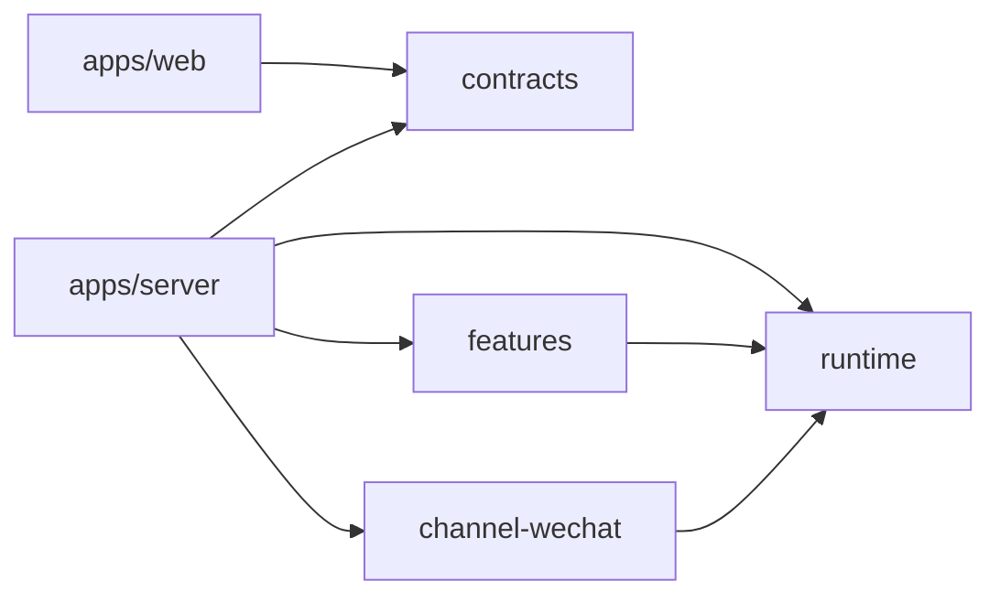

# 多应用、多模块开发约定

项目使用 pnpm workspaces 和 TypeScript project references。源码分为三个应用、四个私有包，保留原生 ESM、HTTP/JSON/SSE 和 Pi Durable 1.1.0。根目录命令统一执行构建、依赖检查与回归测试。

## 应用与包

| 位置 / 包名 | 职责 |
| --- | --- |
| `apps/server` / `@assistant/server` | `main.ts` 读取配置并启动、关闭；`application/` 编排会话、消息、任务和个人资料；`http/` 负责路由、鉴权、SSE 与静态资源 |
| `apps/desktop` / `@assistant/desktop` | Electron 桌面入口，复用本地服务与网页，提供独立数据目录和桌面打包 |
| `apps/web` / `@assistant/web` | 原生 TypeScript 界面；聊天、附件、会话列表、任务中心、个人资料与界面组件分别组织 |
| `packages/contracts` / `@assistant/contracts` | 可序列化的 HTTP/SSE 数据类型，浏览器和服务端共同使用；无 Node 或 SDK 依赖 |
| `packages/runtime` / `@assistant/runtime` | 模型目录、会话索引、Harness 与 SQLite 生命周期；不注册具体助手功能 |
| `packages/features` / `@assistant/features` | 笔记、网页阅读、附件、计划、提醒、子 Agent、记忆、技能和只读知识检索 |
| `packages/channel-wechat` / `@assistant/channel-wechat` | 微信入站验证、会话绑定、回复游标与发送队列 |

`features` 按能力划分内部目录，通过包入口导出当前实际使用的功能。应用入口显式注册助手、前台委派、任务中心和个人资料扩展。通知与知识库配置由应用注入；模块导入不启动服务、不打开数据库。



图中表示代码依赖。Web 实际通过 HTTP/SSE 与服务端通信。生产部署由服务端同源提供 Web 构建产物；同一数据库仍由一个后端运行时负责调度。新增 CLI 等客户端时，可以新增应用，通过协议接入已有服务。

## 开发命令

Node.js 最低版本为 22.19，与 Pi SDK 的运行要求一致。开发依赖固定 TypeScript 6.0.3；模块边界检查使用其 JavaScript Compiler API，升级 TypeScript 7 前需迁移该脚本。`@types/node` 保持 22.x，与部署使用的 Node 主版本一致。

工作区由 `pnpm-workspace.yaml` 声明，内部依赖使用 `workspace:*`；根 `packageManager` 固定 pnpm 12.9.1。通过 Corepack 使用固定版本，安装时只允许 Electron 和 esbuild 执行必要的依赖构建脚本。

在仓库根目录执行：

```bash
pnpm install --frozen-lockfile
pnpm run check
pnpm test
# 已配置并注入真实模型环境变量后启动
pnpm run dev
```

- `pnpm run build`：按依赖顺序编译源码和测试，将网页静态资源复制到 `apps/web/dist/`。
- `pnpm run check`：增量编译并检查类型、依赖声明、跨包路径、循环依赖以及浏览器/Node 边界。
- `pnpm test`：构建后运行各包、各应用及跨模块集成测试。浏览器模块链接测试使用 Node 的实验性 VM Modules；它不代替真实浏览器交互验收。
- `pnpm run dev`：构建后启动服务，并保留进程退出自动重启功能。源码修改后需要重新构建；此命令不提供文件监听。
- `pnpm start`：构建并启动；已构建环境可直接执行 `node apps/server/dist/main.js`。

只处理一个工作区：

```bash
pnpm --filter @assistant/runtime run build
pnpm --filter @assistant/web run build
pnpm --filter @assistant/server run check
pnpm --filter @assistant/features test
pnpm --filter @assistant/web test
```

工作区构建会先构建自身的 TypeScript 引用。Web 构建可独立执行；完整网页访问需要同时构建并启动 server。单包 `check` 检查该包及其依赖，仓库依赖规则由根目录 `pnpm run check` 执行。

## 必须保持的边界

1. 跨包通过 `@assistant/*` 公开入口导入，禁止引用其他包的 `src/` 或 `dist/`。
2. `contracts` 仅提供类型；Web 的外部包引用仅允许这些类型，运行时代码保持浏览器原生相对模块导入。
3. 服务端只使用 Node 类型环境；Web 使用 DOM 类型环境；不能通过共享全局类型掩盖依赖错误。
4. 环境变量在服务端入口读取。模型凭据、通知目标、知识库目录和微信配置以参数传递，不在功能包内读取进程环境。
5. 跨功能用例放在 `apps/server/src/application/`。例如，归档会话要先检查微信绑定，再停止计划、提醒和后台任务，最后更新会话列表。

这些约定由 `scripts/check-boundaries.ts` 和各工作区配置共同约束。仅增加依赖声明不足以绕过已规定的包依赖方向。

## 持久化与协议兼容

目录迁移保持 HTTP 路径、SSE 数据和 SQLite 文件名称不变。已有 Document 的 `kind`、`version`、作用域、历史与 Fork 行为，以及 Task 的名称和版本保持不变。

四类旧文档的 `history` 原先未设置；代码显式保留 `undefined`，不能仅为满足 SDK 类型而改成 `latest`。`tests/fixtures/durable-definitions.json` 来自迁移前代码，回归测试会核对定义。

静态文件改为支持多层模块路径，仍限定在 Web 产物目录内，只提供 HTML/CSS/JS，并检查路径穿越与目录外符号链接。旧 `/app.js` 入口仍可使用。

## 测试与部署

单元测试随工作区放在 `tests/` 中，跨应用 HTTP、持久化、崩溃恢复和模拟微信测试位于根目录 `tests/integration/`。生成目录为各工作区的 `dist/`、`dist-tests/`、根目录的 `.build/` 和 `tests/dist/`，不提交生成产物。

Docker 构建阶段安装开发依赖并编译；运行阶段只安装生产依赖并保留七个工作区的包描述、服务端所需产物与 pnpm workspace 链接；Electron 二进制不进入服务端镜像。微信外部 wx-bot 构建继续位于 `deploy/wechat/`。

本次组织结构调整不升级 Pi SDK、不更换数据库、不更换 UI 框架。真实模型、真实微信、浏览器交互和实际 Docker 部署需要分别验收。
